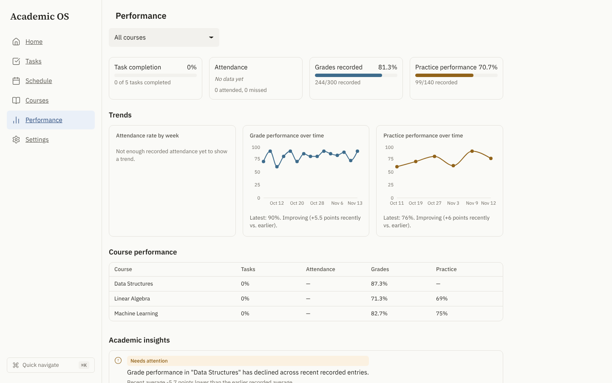
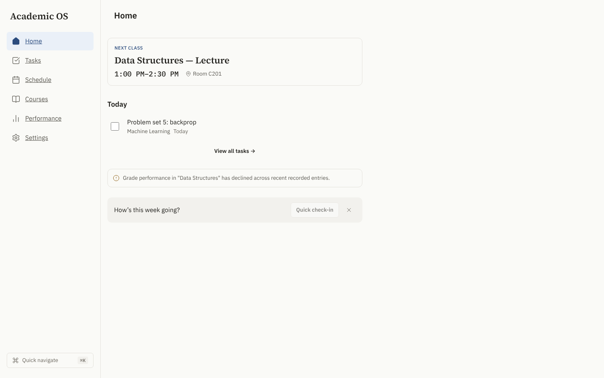
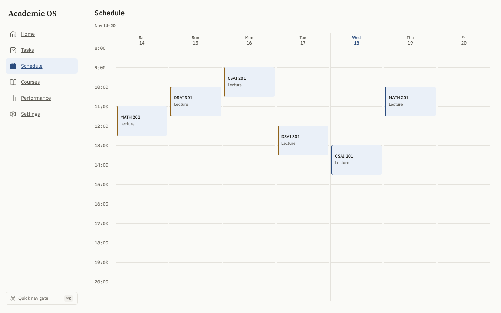
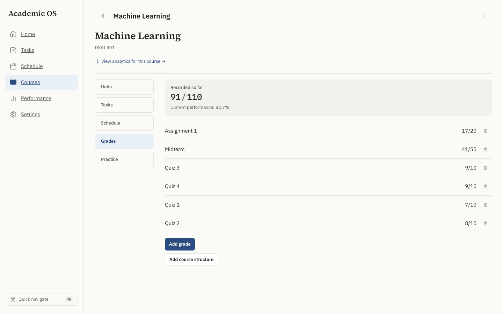
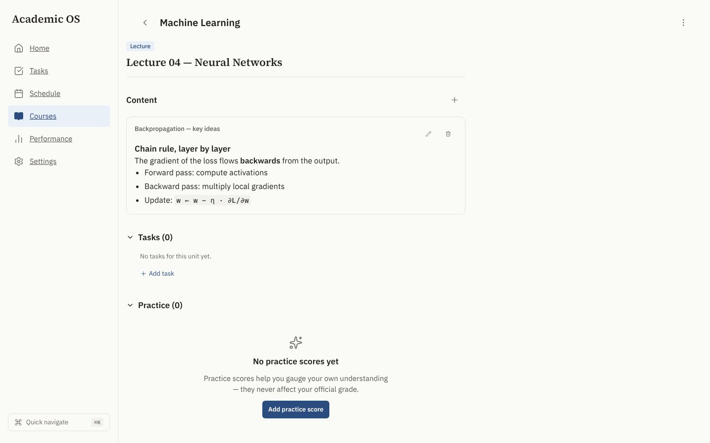
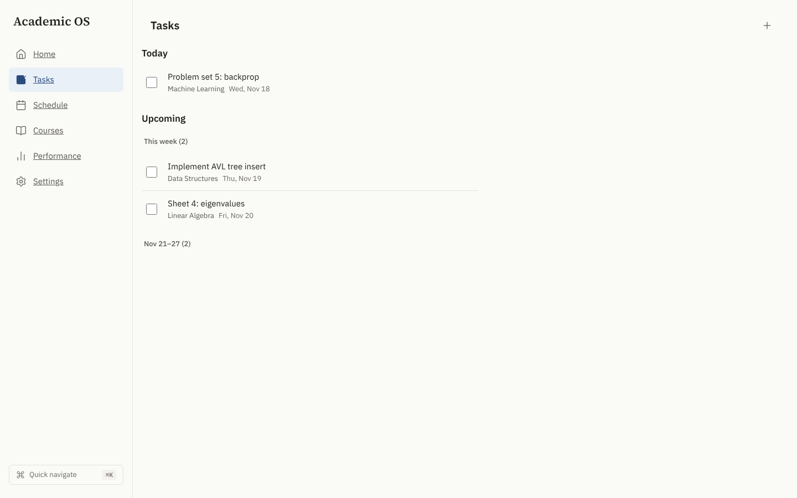
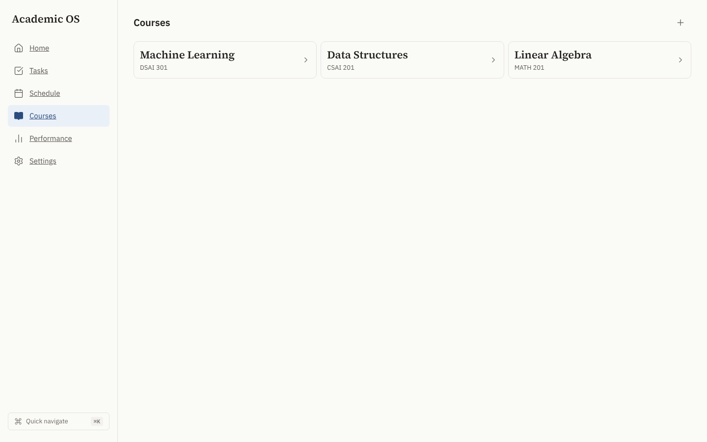
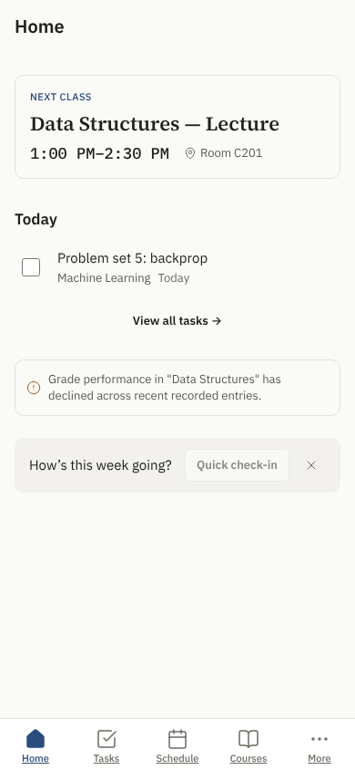
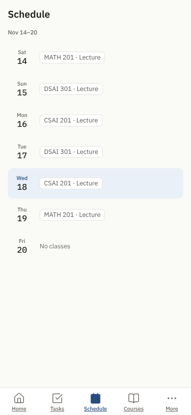
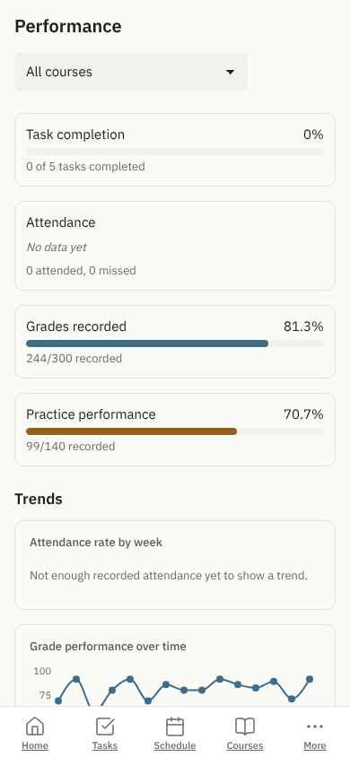

# Academic OS

**A local-first academic operating system: courses, schedule, tasks, attendance, grades, practice and analytics in one installable app — with every byte of data staying on your device.**

[](https://github.com/omar-issam-abdelhalim/academic-os/actions/workflows/ci.yml)


[](./LICENSE)

### 👉 [Open Academic OS](https://omar-issam-abdelhalim.github.io/academic-os/)

No account, no server, no tracking. Install it from the browser and it works offline.



---

## Contents

- [Why](#why)
- [Features](#features)
- [Screenshots](#screenshots)
- [Architecture](#architecture)
- [Tech stack](#tech-stack)
- [Quality](#quality)
- [Getting started](#getting-started)
- [Documentation](#documentation)
- [Principles](#principles)
- [License](#license)

---

## Why

A semester is spread across a timetable, a to-do app, a notes app, a grades spreadsheet and memory. Academic OS puts the whole loop in one place — **semester → course → unit → class → task → attendance → grade → practice → analytics** — and keeps it private by design: everything is stored in the browser's IndexedDB, and nothing leaves the device unless you export it.

## Features

| Area | What you get |
|---|---|
| **Home** | Current or next class, today's tasks, and one plain-text insight — not a dashboard of widgets. |
| **Courses & units** | Courses (university lectures, online series or self-study, organized with global tags) broken into units with Markdown notes, files, images and videos. |
| **Schedule** | Recurring weekly classes that generate real occurrences; editing a template never rewrites attendance already recorded. Week grid on desktop, day list on mobile. |
| **Tasks** | Due dates, course/unit links and a full completion history (an event log, not a single overwritable flag). |
| **Attendance** | One-tap Attended / Missed / Cancelled on any class occurrence. |
| **Grades** | *Simple mode* (a flat list) or *Structured mode* (categories with point budgets), with current performance, remaining points, maximum possible final score and the score required for a target. |
| **Practice** | Practice scores tracked separately from official grades, so self-testing never distorts the real picture. |
| **Analytics** | Task, attendance, grade and practice metrics; trends classified as improving / declining / stable from documented thresholds; ranked insights with their evidence. Deterministic — no AI-generated numbers. |
| **Reminders** | In-app "class starting soon" banner, plus optional system notifications while the app is open (asked for only when you turn reminders on). |
| **Semester lifecycle** | Versioned JSON export validated against its own schema, safe import (untrusted input, preview, explicit confirmation), a separate media export, and "Start New Semester" that keeps your tags. |
| **PWA** | Installable on Android, iOS and desktop; works offline; shows an update prompt instead of reloading mid-task. |

## Screenshots

| Home | Schedule |
|---|---|
|  |  |

| Course grades | Unit notes |
|---|---|
|  |  |

| Tasks | Courses |
|---|---|
|  |  |

**Mobile**

<p>
  
  
  
</p>

## Architecture

```
React UI (feature screens)
   │  reactive queries (dexie-react-hooks)
   ▼
Repositories  ── src/data/repositories/   one module per entity, transactional writes
   │
   ▼
Domain layer  ── src/domain/              pure, unit-tested rules: grade math, schedule generation,
   │                                       analytics, trend classification, insights, archive schema
   ▼
IndexedDB (Dexie)                          two databases: preferences (survive semesters) and the
                                           active semester; task completion kept as an event log
```

- **Local-first:** no backend and no network calls for data; the service worker caches only the static app shell, never user data.
- **Derived, not duplicated:** statistics are computed from immutable records, so a fixed formula corrects every past number automatically.
- **Untrusted input at the edges:** imported archives are parsed defensively, validated with a versioned Zod schema and rebuilt field by field.

Full detail: [ARCHITECTURE.md](./docs/ARCHITECTURE.md) · [DATA_MODEL.md](./docs/DATA_MODEL.md) · [SECURITY.md](./docs/SECURITY.md).

## Tech stack

| Layer | Choice |
|---|---|
| UI | React 19, TypeScript (strict), React Router, CSS Modules with design tokens, Lucide icons |
| Data | Dexie (IndexedDB) + dexie-react-hooks, Zod for schemas |
| Charts | Recharts |
| PWA | vite-plugin-pwa (Workbox), self-hosted IBM Plex fonts for full offline use |
| Build | Vite |
| Testing | Vitest + Testing Library + fake-indexeddb; Playwright + axe-core for end-to-end, PWA, responsive and accessibility checks |
| CI/CD | GitHub Actions → GitHub Pages; Dependabot for dependency updates |

## Quality

Every push to `main` must pass the full gate before it deploys:

| Gate | Command |
|---|---|
| Dependency audit (critical) | `npm audit --audit-level=critical` |
| Type check | `npm run typecheck` |
| Lint · formatting | `npm run lint` · `npm run format:check` |
| Unit & integration tests — **198** | `npm test` |
| Production build | `npm run build` |
| End-to-end tests — **168** (workflows, PWA/offline, 7 viewport sizes, axe-core accessibility) | `npm run test:e2e` |

## Getting started

```bash
git clone https://github.com/omar-issam-abdelhalim/academic-os.git
cd academic-os
npm install
npm run dev          # http://localhost:5173
```

```bash
npm test             # unit + integration
npx playwright install chromium
npm run test:e2e     # end-to-end against the production build
npm run build        # production build in dist/
```

The full command reference and Git workflow are in [DEVELOPMENT.md](./docs/DEVELOPMENT.md).

## Documentation

The project is documentation-first; each document is the source of truth for its area.

| Document | Covers |
|---|---|
| [PRODUCT_SPEC.md](./docs/PRODUCT_SPEC.md) | What the product does and its business rules |
| [ARCHITECTURE.md](./docs/ARCHITECTURE.md) | Stack, storage, PWA strategy, hosting |
| [DATA_MODEL.md](./docs/DATA_MODEL.md) | Entities, relationships, storage design |
| [SECURITY.md](./docs/SECURITY.md) | Threat model and privacy commitments |
| [DEVELOPMENT.md](./docs/DEVELOPMENT.md) | Workflow, versioning, testing strategy |
| [ROADMAP.md](./docs/ROADMAP.md) | The staged plan, complete through `v1.0.0` |
| [UX architecture](./docs/STAGE_1A_UX_ARCHITECTURE.md) · [Design system](./docs/STAGE_1B_DESIGN_SYSTEM.md) | Navigation, flows and visual tokens |
| Stage reports: [2](./docs/STAGE_2_REPORT.md) · [3](./docs/STAGE_3_REPORT.md) · [4](./docs/STAGE_4_REPORT.md) · [5](./docs/STAGE_5_REPORT.md) | What each stage delivered and how it was verified |
| [CHANGELOG.md](./CHANGELOG.md) | Release history |

## Principles

- **Local-first:** no accounts, no mandatory backend, no cloud database. Academic data lives on the user's device.
- **Flexible, not university-only:** a course can be a university lecture, a video series or self-study, organized with global tags rather than a rigid type system.
- **Grades and practice stay separate:** official grades are never mixed with practice performance.
- **Correlation, not causation:** analytics describe patterns in your own data and never claim a behavior caused an outcome.
- **Export and delete are independent:** exporting never deletes; clearing a semester never happens as a side effect.
- **Full history, not just current state:** task completion is an event log, not a single overwritable flag, so analytics and exports stay accurate.

## License

[MIT](./LICENSE) © Omar Issam
